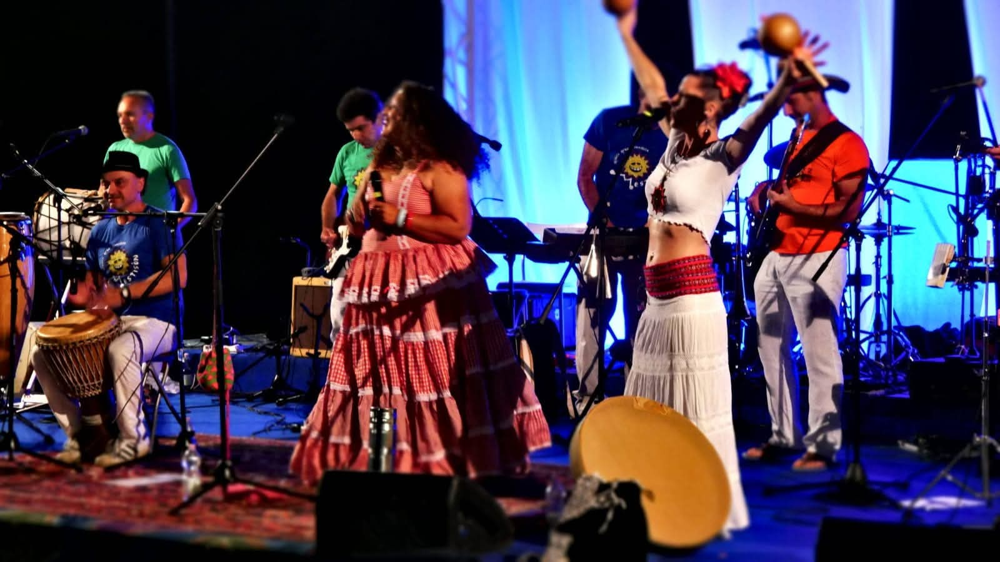

| |
|---|
|  |
| <video src="video/promo_2025.mp4" controls width="100%"><video>  |
|
# Mestisòn

allegri e coinvolgenti interpreti della musica folklorica afro-caraibica, vi
accompagneranno in questo meraviglioso viaggio nell’entroterra e le calde coste
del caraibi colombiano. Mestisòn è energia pura. Una miscela esplosiva di ritmi,
canti e danze dove gli strumenti a percussione tradizionali si mescolano
sapientemente a strumenti più moderni come la chitarra, il basso e il sax. Un
connubio di sonorità tra il moderno e l’arcano dove CUMBIA, MAPALè, SòN
CORRIDOS (e molti altri ritmi tradizionali) si fondono al funky, reggae, rock e
salsa. Costumi vicaci e allegre coreografie regalano uno spettacolo unico e
originale.

# Un po di noi...

Il progetto musicale nasce nel 2011 a Treviso, direttore musicale della band è Luis
Fernando Giraldo Bedoya (Pereira - Colombia). Numerose le esibizioni nei locali
della provincia e le collaborazioni con diverse associazioni presenti sul territorio
della Marca.
Partecipano a diversi Festival nel nord-est tra cui ricordiamo “SUONI DI MARCA” -
2012 e 2011 come band supporto a BUENA VISTA SOCIAL CLUB.
Partecipano inoltre al festival internazionale FOLK EST 2016-2017 e RITMI E
DANZE DAL MONDO 2017-2014 |